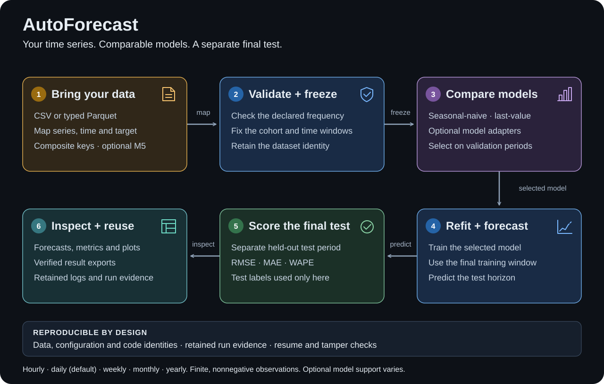

# AutoForecast

Run reproducible forecasting experiments on hourly, daily, weekly, monthly, or yearly time series.
Daily is the default. AutoForecast validates
input data, compares models on validation periods, refits the selected model, and scores a
separate test period. Each run retains its data identities, configuration, forecasts, and metrics.

Start with CSV or Parquet. Column names and series keys are configurable; M5 is an optional
benchmark, not a required data format. Data and outputs stay local unless you explicitly configure
an external tracking service.



## Requirements and installation

- Python 3.12 or 3.13 on Linux or macOS.
- Java 17 for the local Spark preparation and evaluation runtime.
- Enough local disk and memory for your dataset. The quickstart uses two small series.

```bash
git clone https://github.com/ravinderkhatri/autoforecast-research.git
cd autoforecast-research
python3.12 -m venv .venv
source .venv/bin/activate
python -m pip install '.[timeseries,plots]'
```

Set `JAVA_HOME` to your Java 17 installation if it is not already configured. For a small local
run, limit Spark to two cores and a 1 GB JVM heap:

```bash
export FORECAST_SPARK_CORES=2
export FORECAST_SPARK_MEMORY=1g
```

The `timeseries` extra includes the local data/runtime dependencies. The two built-in baselines
need neither a GPU nor a model download. Additional model libraries are optional.

## Run the example

Create an experiment outside this checkout:

```bash
cd ..
autoforecast init-example my-experiment
autoforecast freeze --project-root my-experiment --source data
```

The default example creates 84 observations: two `(shop, sku)` series across 42 days. Preparation retains
both series, with no exclusions. Each seven-day forecast scores the same 14 cells. `freeze`
prints an absolute path ending in `benchmark.json`; use that exact path:

```bash
autoforecast run --project-root my-experiment \
  --benchmark /absolute/path/printed/by/freeze/benchmark.json
```

The run compares seasonal-naive and last-value forecasts at two validation origins. It selects
a model using validation scores, refits through February 4, and tests on February 5–11. Test
labels are supplied only to the final scorer. Running the same command again resumes the same
campaign. Changed inputs or settings create a different identity.

Use `--frequency` to create the same small experiment at another cadence:

```bash
autoforecast init-example hourly-experiment --frequency H
autoforecast init-example monthly-experiment --frequency MS
autoforecast init-example yearly-experiment --frequency YS
```

Each example contains two series and 42 periods. Its generated configuration uses a synthetic
seven-period season and seven-period horizons; those numbers count observations, not days.

## Choose a frequency

Set `dataset.panel.frequency` explicitly for non-daily data. The same declaration applies to
the input keys, validation origins, final cutoff, forecast keys, scoring, and result export.

| Frequency | Input labels | One forecast period |
|---|---|---|
| `H` | Exact-hour timestamps, such as `2024-01-01T06:00:00` | One hour |
| `D` (default) | ISO dates, such as `2024-01-01` | One day |
| `W` | ISO dates on a consistent weekday | Seven days, preserving that weekday |
| `M` or `ME` | Month-end dates | Next calendar month end |
| `MS` | First day of each month | Next calendar month start |
| `Y` or `YE` | December 31 | Next calendar year end |
| `YS` | January 1 | Next calendar year start |

Monthly and yearly boundaries use the calendar. For example, a month-end forecast after
January 31, 2024 targets February 29 and then March 31. Off-boundary dates are rejected instead
of shifted. Hourly timestamps must be timezone-naive and have zero minutes, seconds, and
fractional seconds. Normalize timezone-aware data to your intended timeline before importing it.
The workflow does not infer a frequency, resample observations, or change their labels.

Horizons and `season_length` always count periods. For example, hourly data with a daily seasonal
pattern uses `season_length: 24`; monthly data with an annual pattern uses `season_length: 12`.

## Use your own data

Create the example project as a template, then replace its data and edit these files:

| File | What to change |
|---|---|
| `dataset.yaml` | Dataset ID; series, time, and target columns; frequency; season length; optional feature roles. |
| `recipe.json` | Source keys, history starts, origins, horizons, cutoff, target unit, missing-value policies, and metric. |
| `campaign.yaml` | Matching dates, candidates, scoring metric, compute limits, and training budgets. |
| `models/*/model.yaml` | Model profiles selected by the campaign. |

For example, a CSV can use these columns:

```csv
store,product,date,units
north,001,2024-01-01,0
north,001,2024-01-02,3
south,002,2024-01-01,8
south,002,2024-01-02,5
```

Convert your complete history to typed Parquet:

```bash
autoforecast import-csv observations.csv my-experiment/custom-data/observations.parquet \
  --id-columns store product --date-column date --target-column units
```

CSV keys remain strings, so `001` stays distinct from `1`. Non-hourly dates must be `YYYY-MM-DD`.
For hourly CSV data, pass `--frequency H` and use timestamps such as `2024-01-01T06:00:00`.
For other non-daily data, pass the matching frequency, such as `--frequency MS`.
The importer selects the mapped columns and records excluded columns, source checksum,
date range, row count, and series count in the Parquet file's metadata. Preparation records the
output checksum as part of its source identity. The importer refuses
conflicting output files. Use typed Parquet directly when you need additional features or
integral keys. The CSV convenience importer reads the selected observations into memory.

Mapped CSV headers and all Parquet column names must match `[A-Za-z_][A-Za-z0-9_]*`.
For example, rename `meter.id` to `meter_id` and `daily usage` to `daily_usage` before import.
Column names must be distinct ignoring case; names beginning with `__af_` in any case are
reserved for prepared data. Series key values must be nonblank;
string IDs such as `001` and integral IDs such as `0` are valid.

Map this example in `dataset.yaml`:

```yaml
schema_version: 1
dataset:
  id: my-timeseries-data
  panel:
    series_col: store
    time_col: date
    target_col: units
    frequency: D
    target_estimand: observed_nonnegative
    season_length: 7
```

In `recipe.json`, set `source_keys` to `["store", "product"]` and `target_unit` to `units`.
`source_keys` defines the complete series identity; preparation creates a reversible composite
ID. Set `training_start`, `validation_origins`, `validation_horizon`, `final_train_cutoff`, and
`final_test_horizon` to time points and period counts supported by your history. Copy those temporal values
into `campaign.yaml`. Validation windows must end by the final training cutoff. The test window
starts at the next period. Update the dataset source labels in the campaign to describe your data.

```bash
autoforecast freeze --project-root my-experiment --source custom-data
```

Use the newly printed benchmark path with `autoforecast run`. The two-row-per-series excerpt
above only illustrates the format; training requires complete history at the declared frequency over your chosen
training, validation, and test windows.

### Data rules

- The release workflow supports finite, non-negative, observed values at the declared frequency. Fractional values
  work with the baselines; count models can impose integer-target requirements.
- Hourly Parquet keys use timezone-naive timestamps. Other cadences use dates; midnight
  timestamps are accepted only when conversion preserves the full time key. Each series/time
  must appear once. Hourly values on the same day remain distinct observations. Legacy INT96
  timestamps require an embedded Arrow schema declaring timezone-naive values; otherwise,
  convert the source to typed dates or timezone-naive timestamps before importing it.
- The cohort is fixed from series present by the first validation origin in the selection
  source. The manifest reconciles all source series, exclusions, and the retained cohort.
- New studies use recipe version 2. `history_missing` and `actual_missing` default to `zero`.
  Absent expected rows and null targets are filled with zero after the declared history start.
  Original missingness is retained. A recorded zero remains an observed value. NaN, infinity,
  negative targets, duplicate rows, and invalid keys are errors, not missing values.
- Set `actual_missing` to `mask` to exclude originally missing actuals from both validation
  and test metrics. Forecasts must still cover every expected cell. Coverage reports include
  expected, originally missing, zero-filled, excluded, and scored counts for every series.
- Every model must meet its minimum history and window requirements for the whole frozen
  cohort before fitting. A model cannot silently drop short series.
- Only the current version-2 preparation recipe and study manifest are supported.
- New series default to an error. The explicit `exclude_after_first_origin` recipe policy
  excludes series absent from the initial cohort and records the count.
- `history_policy: fixed` requires overlapping history to agree across snapshots.
  `revised_snapshot` permits declared corrections and creates a new benchmark identity.
- Historical features use `past_only`. Prepared future-known features require declared
  availability evidence and an observation-state column. Unknown future availability is refused.

Separate snapshots can be supplied explicitly:

```bash
autoforecast freeze --project-root my-experiment \
  --selection data/selection --final-training data/training \
  --validation-score data/validation-actuals --final-score data/test-actuals
```

Parquet directories must contain `.parquet` parts, optionally under Hive partition directories.
Hidden completion markers are ignored. Visible sidecars, summary metadata, streaming logs,
links, and special files are refused so every reader-visible observation is authenticated.

Signed targets, learned imputation, raw warehouse feeds, and cloud execution are outside this
release workflow. Use `observed_nonnegative` for measured quantities,
including fractional values such as energy use. The two built-in baselines support this target.
Use `sales_given_availability` for observed retail sales. Optional retail models declare their
supported targets and reject incompatible inputs; none of these observed-target contracts
infers unobserved demand.

## Freeze a reusable study

The four logical data roles distinguish fitting history from scoring actuals. Validation uses
`validation_score`, not the refit target. Test labels stay outside fitting and model selection.
`--source` assigns one input snapshot to all four roles. Identical prepared roles share storage;
the manifest records their logical identities and physical paths.

A version-2 recipe must declare `metric` (`rmse`, `mae`, `wape`, or `wrmsse`). To give retained
series different usable history starts, add an exact source-key map and a derivation rule:

```json
"series_starts": {
  "rule": "Usable history declared from records available at the first validation origin",
  "values": [
    {"keys": {"shop": "a|b", "sku": 1}, "start": "2024-01-01"},
    {"keys": {"shop": "a", "sku": 2}, "start": "2024-01-08"}
  ]
}
```

Declare every retained series exactly once. Starts must lie between `training_start` and the
first validation origin and align with the frequency. Preparation never pads before them.
Without this map, every series uses `training_start`. The first observed row is not treated as
proof of a launch date. Feed completeness, launch/delist rules, and missingness reasons remain
caller responsibilities.

The manifest's `study_id` binds the cohort, declared starts, prepared values, original missing
flags, windows, policies, and metric definition. It is separate from model-run, HPO-study, and
MLflow identifiers. Studies support profile defaults, manual parameters, inner HPO, and verified
HPO reuse. Reuse a verified study by ID:

```bash
autoforecast run --project-root my-experiment --study-id STUDY_ID
```

IDs resolve existing manifests under `.autoforecast/benchmarks`; they never create or infer a
study. Creation requires explicit input data and a recipe. Repeating `freeze` with
`--study-id STUDY_ID` verifies that the inputs reproduce that contract. Changed labels or rules
require a new identity; existing artifacts are never overwritten.

RMSE, MAE, and WAPE aggregate the available cells under the declared policy. A series with no
scoreable cells has an unavailable score, and an empty aggregate is also unavailable. WAPE is
unavailable when total actual volume is zero. An unavailable validation score cannot select a
model; an unavailable held-out test score is reported without changing the selection.

Study `wrmsse` uses a single-level weighted mean of per-series RMSSE. It does not use M5's
hierarchy. Supply `--scoring-references references.parquet` with one row for every retained
series and every tuning, validation, and test boundary:

| Column | Value |
|---|---|
| `keys` | Struct containing the recipe's source-key names and exact types |
| `stage` | `tuning`, `validation`, or `test` |
| `origin` | Canonical origin string at the declared frequency |
| `weight` | Finite non-negative weight; positive total at each boundary |
| `scale` | Mean squared naive-change scale; zero or null means undefined |

Weights and scales are supplied by the caller and frozen with the study. The score is
`sum(weight * sqrt(MSE / scale)) / sum(weight)`. Under masking, each series' MSE uses its
observed cells. If any retained series has no scoreable actuals or an undefined scale, WRMSSE
is unavailable. Weights are never redistributed.

The `sft`, `hmfnet`, `pact`, `tft_q`, and `tft_hnb`
adapters select checkpoints with the study metric, including its original missing-value mask
and any supplied weights and scales. Training loss remains model-specific. Final refit uses
the selected update budget without test labels. These native adapters retain their daily-data,
target, feature, and history requirements; use a compatible adapter for other frequencies.

### Use a study from Python

Install the `timeseries` extra and start a supported Spark session. The study interface
works in notebooks, scripts and jobs. It borrows that session and never stops it. Set the
experiment project once; its existing `.autoforecast/benchmarks` directory is the local
study registry:

```python
from autoforecast.study import load_study
from autoforecast.project import experiment_project

with experiment_project("/absolute/path/to/my-experiment"):
    with load_study(study_id) as study:
        training = study.training_data
        validation_actuals = study.validation_data
        refit = study.refit_data
        testing_actuals = study.testing_data

        # Fit your existing model on training, then refit on refit.
        # Keep testing_actuals outside all fitting and model selection.
        # Produce two Forecast objects as shown in the runnable example below.
        result = study.run_validation(
            validation_forecasts=validation_forecasts,
            testing_forecasts=testing_forecasts,
            model_id="my-model",
        )
        print(result["validation"]["score"])
        print(result["test"]["score"])
        print(result["result_path"])
```

For a standalone registry, pass `registry_root=...` to `load_study`. Pass `spark=spark` when
the caller's session is not active. An absent ID in an existing registry raises
`FileNotFoundError`; access failures and changed artifacts remain separate errors.
Loading never creates a study.

For setup shared across notebook cells or functions, bind these arguments once with standard Python:

```python
from functools import partial
from autoforecast.study import load_study as _load_study

load_study = partial(_load_study, registry_root="/path/to/registry", spark=spark)
study = load_study(study_id)  # Later cells need only the ID; close study when finished.
```

All four data properties return Spark DataFrames over verified private snapshots, sliced to
the intended stage. They keep source key names, the frozen internal series ID, and
`__af_original_missing`. `study.panel` exposes the column names, cadence and target estimand;
`study.series_mapping` and `study.series_starts` provide exact source keys, internal IDs,
and `__af_history_start`. `study.policies`, `study.metric_definition`, and
`study.scoring_references` expose the frozen missingness and scoring settings.

| Inclusive range | Meaning |
|---|---|
| `training_date_range` | Overall history start through the initial training cutoff |
| `validation_date_range` | Validation forecast and actual comparison window |
| `refit_date_range` | Overall history start through the final refit cutoff |
| `testing_date_range` | Full planned final evaluation window |
| `forecasting_date_range` | Alias of `testing_date_range` |

Ranges contain Python dates, or datetimes for hourly studies. Each series also retains its
own history start. Missing actuals never shorten a range. This interface requires exactly
one validation origin; it rejects multi-origin studies explicitly. Study settings cannot be
edited in place. Use the dataframes inside the study's lifetime; `close()` or leaving its
context releases the private snapshots.

Predictions use the existing `autoforecast.panel.Forecast` contract. Its Parquet rows must
contain `series_id`, `date`, and finite nonnegative numeric `yhat`. For hourly predictions,
use timezone-naive `TIMESTAMP_NTZ`; other cadences use `DATE`. Map original keys through
`study.series_mapping`; do not construct internal IDs by concatenating keys. Supply the
correct origin, horizon, cadence, target estimand, series count and emitted-cell count in
each Forecast. Every frozen series/date cell is required, even where actuals are missing.
Duplicate, missing, extra, or wrong-stage predictions are rejected.

Run the complete [study example](scripts/study_example.py) from outside the checkout:

```bash
python -m scripts.study_example /absolute/path/to/new-study-example
```

It creates two tiny series with unequal history starts, freezes them using `freeze_benchmark`,
loads the generated ID, accesses all roles and ranges, converts ordinary Spark predictions
to Forecast objects, and scores both stages. It performs no model training or paid compute.

Each check writes a new `study-runs/run-...` directory beside the registry, retaining
forecasts, per-series scores, coverage, study/model/run IDs and artifact hashes. The existing
scorer controls unavailable scores and WRMSSE weights. The result records verified input
identities; it cannot prove which data external model code trained on. The result records
`training_provenance` as `unverified_external`. This forecast check does not register a model
or create a managed campaign result for `read_results`.

### Tune within a study

Declare inner tuning windows in `recipe.json` **before** freezing the study. For example,
when the first outer validation origin is April 21:

```json
"tuning_windows": [{"origin": "2024-03-31", "horizon": 7}]
```

Every tuning target must precede the first outer validation target. The complete frozen cohort
must have usable history by the tuning origin. The tuning window uses the selection snapshot;
outer validation and test labels never select HPO parameters. Missingness and metric rules
are the same at every boundary.

Install the model's runtime extra and `hpo-optuna` or `hpo-ray`. Copy its profile from
`configs/models/` into your project's `models/` catalog. If the profile declares an
`implementation.config`, copy that configuration to the same relative path in your project.
Its SHA-256 must still match the profile. Choose a history length and training budget that fit
your data and hardware.

Set the candidate in `campaign.yaml` to:

```yaml
models:
  candidates:
    - model_id: sft
      parameters:
        mode: tune
        study_config: hpo.yaml
```

Create `hpo.yaml` with explicit data ranges and a trial budget. This template uses two series
whose selection snapshot covers January 1 through April 21; replace its IDs, hashes, and
ranges with those from your own study:

```yaml
schema_version: 1
study:
  id: sft-inner-search
  model_config: models/sft/model.yaml
  backend: optuna
  direction: minimize
  objective: validation/objective
  max_trials: 10
  top_k: 1
  seed: 7
  comparability_fingerprint: STUDY_ID
  evaluator: builtin
  data:
    id: selection-snapshot
    fingerprint: SELECTION_ARTIFACT_SHA256
    observed_date_range: ['2024-01-01', '2024-04-21']
    training_date_range: ['2024-01-01', '2024-03-31']
    validation_date_range: ['2024-01-01', '2024-03-31']
    validation_target_date_range: ['2024-04-01', '2024-04-07']
    test_date_range: ['2024-04-08', '2024-04-14']
    test_target_date_range: ['2024-04-08', '2024-04-14']
    training_series: 2
    validation_series: 2
    test: reserved_not_evaluated
```

`fingerprint` is the frozen manifest's `artifacts.selection`. Both series counts must equal
the frozen cohort. The training range ends at the inner origin; validation targets match the
declared tuning window. The reserved inner test range is not evaluated by HPO. The model
profile defines the search space. Run the same `autoforecast run --study-id ...` command after
configuring the campaign.

To reuse its retained `selection.json`, change the candidate mode to `reuse_tuned`, keep
`study_config`, and add `selection: /path/to/selection.json`. Reuse verifies the study boundary,
data, model, training protocol, and executable provenance. Changing those inputs requires a
new tuning run. Defaults and manual parameters do not require tuning windows.

Campaign requests use `schema_version: 6`; standalone run requests use `schema_version: 3`.
The checked-in examples declare `precision: 32-true` to preserve their FP32 settings. New
requests without an explicit precision use `16-mixed`; checkpoint continuation remains FP32.
Use a current example as a starting point. Older request and resolved-artifact formats are
rejected rather than translated.

## Inspect results

`run` prints the campaign directory. It contains stage logs, run bundles, selection information,
forecasts, metrics, and source identities. Read and export verified results:

```python
from pathlib import Path
from autoforecast.results import read_results, export_results, comparison_plot

results = read_results('/path/printed/by/run')
print(results.rows.to_pandas())
print(results.metadata['frequency'])
print(results.metadata['final_score'])
export_results(results, Path('comparison-export'))
comparison_plot(results, series_id=results.rows['series_id'][0].as_py(),
                output=Path('comparison.png'))
```

All candidates at a scoring boundary must return the same forecast keys. The study freezes
actual coverage independently of model output. Exports include `series-scores.parquet` with
per-run scores and coverage, including zero-coverage series.
Result reading and resume reject changed retained artifacts. The synthetic example checks the
pipeline, not real-world predictive accuracy.

The exported `target_date` column retains timestamps for hourly forecasts and dates for the
other cadences. Plots use those same forecast periods, including calendar month and year boundaries.

To score existing forecasts against revised actuals, freeze a new study with matching forecast
boundaries and cohort, then write a separate post-hoc result:

```bash
autoforecast rescore --project-root my-experiment \
  --campaign /path/to/original/campaign --study-id NEW_STUDY_ID \
  --output rescored-results
```

The output retains original run/model/forecast identities and both study identities. It does
not refit models or replace the original selection and scores. Changed forecast grids are
refused. Use a fresh output directory for each rescoring operation.

## Models and M5

The maintained model catalog is in `configs/models/`. Optional extras include `classical`,
`shallow`, `custom-torch`, `tft`, `autogluon-zoo`, and `timesfm`. Install only the runtime for your selected model.

The custom model families include MFT, SFT, HMFNet, PACT, TFT-Q, and TFT-HNB.
Each adapter declares its input, horizon, device, and parameter requirements. A model being
listed does not mean it supports every dataset or device. The installed release check exercises
the two built-in baselines across all five frequency families. Optional models explicitly declare
their supported frequencies and reject incompatible inputs before execution; their existing
daily-model contracts do not become hourly or monthly support automatically.

M5 dataset and model requests remain in `configs/datasets/` and `configs/autoforecast/` for
source-checkout workflows. Acquire M5 separately under its dataset terms. Use the prepared
Parquet workflow for ordinary time-series comparisons. Competition WRMSSE needs the M5 hierarchy,
weights, and benchmark-specific evaluation contract; generic RMSE is not that competition score.

To add a maintained model, implement an adapter under `autoforecast/adapters/`, register its
`AdapterDescriptor` in `adapter_contracts.py`, declare its runtime and parameter resolution,
and build a new package. Configuration selects registered code; it cannot load arbitrary plugins.

## Development and verification

| Directory | Responsibility |
|---|---|
| `autoforecast/` | Input contracts, preparation, model adapters, orchestration, scoring, results. |
| `forecast/` | Forecasting models, feature preparation, and scenario calculations. |
| `configs/` | Dataset contracts, model catalog, and example requests. |
| `mlops/`, `provenance/`, `observability/` | Artifact integrity, run provenance, and diagnostics. |
| `spec/` | Data and model specifications; reference data rules live in `forecast/data/`. |
| `scripts/` | Reusable command-line operations and installed-package verification. |

Build a wheel with `python -m pip wheel --no-deps --wheel-dir dist .`, install it in a fresh
virtual environment, then run from outside the checkout:

```bash
python -m scripts.verify_timeseries_release /absolute/path/to/new-daily-check
python -m scripts.verify_timeseries_release /absolute/path/to/new-hourly-check --frequency H --csv
python -m scripts.verify_timeseries_release /absolute/path/to/new-monthly-check --frequency MS
python -m scripts.verify_timeseries_release /absolute/path/to/new-yearly-check --frequency YS
```

These checks cover preparation, isolated workers, validation selection, refit, final scoring,
export, plotting, resume, and tamper rejection. They assert exact forecast keys and reconcile
84 source observations, two retained series, no exclusions, and 14 cells per evaluation.
CI repeats CSV and Parquet workflows for every listed cadence on Python 3.12, with additional
daily checks on Python 3.13. Source tests live beside their modules; optional-model tests require their corresponding extras. Dataset-backed
tests report skips when the external dataset is absent.

With the test extras and `pytest` installed, run `python scripts/run_tests.py`. Each module runs
in a separate process because Spark sessions belong to individual test modules. The runner
also uses the same Python interpreter for Spark workers and the test driver.

No datasets, trained weights, experiment outputs, or credentials are distributed in this
repository. Third-party libraries and downloaded models retain their own licenses and terms.
