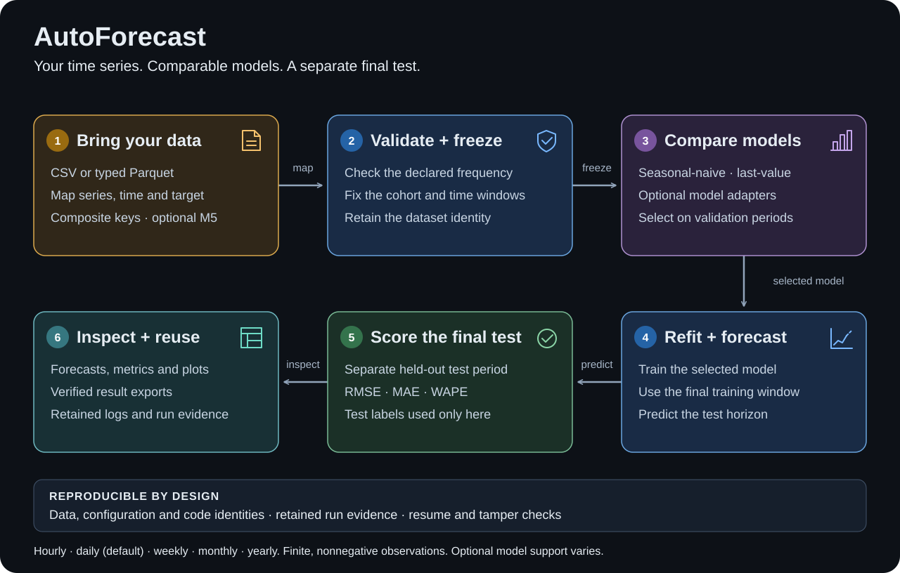

# AutoForecast

Compare forecasting models on the same data and save their predictions, scores and fitted models.
Use the included models or connect your own Python model.

For example, you might want to predict next week's sales for each product. AutoForecast checks
your data, tests models on earlier dates, and measures how well the chosen model predicts later dates.



## Start with a small example

You need **Python 3.12 or 3.13** and **Java 17**. Linux x86_64 and macOS Apple Silicon are supported.

```bash
git clone https://github.com/ravinderkhatri/autoforecast-research.git
cd autoforecast-research
# If you installed Python 3.13, use python3.13 in the next command.
python3.12 -m venv .venv
source .venv/bin/activate
python -m pip install .

export FORECAST_SPARK_CORES=2
export FORECAST_SPARK_MEMORY=1g

cd ..
autoforecast init-example my-experiment
autoforecast freeze --project-root my-experiment --source data
```

Set `JAVA_HOME` to your Java 17 installation if Spark cannot find Java.
Keep experiment folders outside the library checkout.

The example contains two products over 42 days: 84 observations, with no products excluded.
`freeze` checks the data and saves a **study**: a fixed copy of the data and evaluation rules.
Copy the printed `benchmark.json` path into:

```bash
autoforecast run --project-root my-experiment \
  --benchmark /absolute/path/printed/by/freeze/benchmark.json
```

This compares two simple models and prints the results folder. Each seven-day forecast has
14 values. Running the same command again resumes that campaign.
The example teaches the workflow; it does not establish which model is best for your data.

## Learn one step at a time

Start with the [tutorial guide](tutorials/README.md). Each notebook explains one task:

1. [Run your first forecast](tutorials/01-first-forecast.ipynb)
2. [Register your data](tutorials/02-register-data.ipynb)
3. [Connect your own model](tutorials/03-custom-model.ipynb)
4. [Try settings on earlier dates](tutorials/04-tune-and-backtest.ipynb)
5. [Read predictions and scores](tutorials/05-read-results.ipynb)
6. [Reload work and retry publication](tutorials/06-reload-and-reuse.ipynb)

Already have training and testing DataFrames? Follow [supply your own stages](tutorials/10-supply-your-own-stages.ipynb).
Validation is optional; leaving it out creates no extra split. For application data rules, see
[prepare and check data](tutorials/11-prepare-and-check-data.ipynb).
You can also [create or reuse a study in one call](tutorials/README.md#create-or-reuse-a-study-in-one-call).
To save a source read and build several studies from it, follow
[reuse raw source data](tutorials/13-reuse-source-captures.ipynb). Each study still makes
its own decisions about dates, eligible series and scoring.

Choose an optional destination: [Delta](tutorials/07-publish-delta.ipynb),
[PostgreSQL](tutorials/08-publish-postgresql.ipynb), or [BigQuery](tutorials/09-publish-bigquery.ipynb).
The default saves results to files and needs none of these databases.

## Databricks and shared storage

For setup instructions and current limits, see the
[Databricks tutorial guide](tutorials/README.md#databricks-and-shared-storage).

## Keep saved runs safe

Give each run its own folder and leave saved data and results unchanged.

For example, Monday's run and Tuesday's run use different output folders. Both can
read the same saved study, as long as nobody edits or deletes that study.

If a run stops halfway, keep its folder for troubleshooting and start a fresh attempt.
AutoForecast checks saved results before using them. Do not edit completion files by hand.
On shared storage, permissions and cleanup jobs must protect files that a run is still using.
See [shared-storage examples](tutorials/README.md#keeping-saved-runs-safe) for details.

## What the library keeps

AutoForecast saves the study data, evaluation rules, model settings, selected source files,
forecasts, scores and fitted model files. Loading checks saved evidence without training again.
Cross-validation tries settings on earlier dates; the final test stays separate.

**Predictions stay exactly as the model supplied them, including negative values.**
If your model needs clipping, put that rule in its own recorded code. NaN, infinity,
missing or duplicate forecast cells are errors. Observed values must be finite and nonnegative.
Choose missing-observation rules explicitly; missing is not automatically zero.

Your model can use the supplied training data, dates, parameters and random seed.
Source retention records files; it cannot prove which notebook cells or hidden state were used.
Keep relevant helper code in the configured source roots and settings in the model profile.

By default, registration saves files and records their checksums. Reopening a study
checks those files before using them. Large datasets use Spark for hashing; small
evidence tables use local hashing.

Registration can also keep inputs in a protected database archive. Correcting today's
source does not change an older study. See [keep experiment inputs](tutorials/12-retained-inputs.ipynb)
for the available modes, setup and limits.

## Install other models

From the library checkout, install only what you use:

| Models | Command |
|---|---|
| LightGBM | `pip install '.[shallow]'` |
| MFT, SFT, HMFNet, PACT | `pip install '.[custom-torch]'` |
| TFT | `pip install '.[tft]'` |
| AutoGluon | `pip install '.[autogluon-zoo]'` |
| TimesFM 3 | `pip install '.[timesfm3]'` |
| All above | `pip install '.[all-models]'` |

LightGBM on macOS needs `brew install libomp`. TimesFM 2.5 uses `.[timesfm]` in a separate
environment from TimesFM 3. Installation does not download model weights.
See [model profiles](configs/models/) for settings.

## See what is running

Registration and model runs show progress automatically. No setup call is needed.
The display shows completed and remaining stages. A download can show bytes copied;
a model callback with no progress counter shows elapsed time. The percentage of stages
completed is a stage count, not an estimate of how much runtime remains.
See the [tutorial guide](tutorials/README.md#progress-and-logs) for quiet output,
job logs and failure details.

## Development

Tests live beside the code. Install the `ci` dependency group and required extras,
then run `python scripts/run_tests.py`. Each test module runs in a separate process.
CI checks linting, types, regressions, installed wheels, model extras and real database engines.
Local Linux containers give useful feedback; ARM containers do not replace Linux x86_64 checks.

[Study API](autoforecast/study.py) · [Callback types](autoforecast/study_tuning.py) ·
[Runnable Python example](scripts/study_example.py)

## License

AutoForecast is licensed under the [Apache License 2.0](LICENSE).
